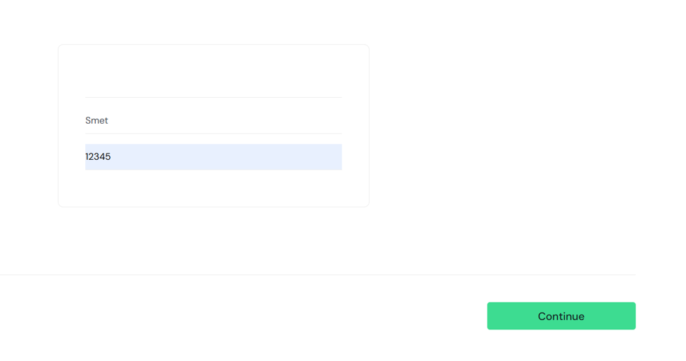

BUG-001 - Поля оформления заказа принимают значения, состоящие только из пробелов

Проект: QA Portfolio - тестирование интернет-магазина
Приложение: SauceDemo
Тип тестирования: Ручное тестирование

Характеристики дефекта
Серьёзность(Severity): Medium
Приоритет(Priority): High
Статус: Подтверждён

Предусловия
•Выполнен вход под пользователем standard_user.
•В корзину добавлен хотя бы один товар.

Шаги воспроизведения
1.Открыть корзину.
2.Нажать Checkout.
3.Ввести в поле First Name только пробелы.
4.Ввести в поле Last Name только пробелы.
5.Ввести в поле Zip/Postal Code только пробелы.
6.Нажать Continue.
7.Убедиться, что открылась страница Overview.
8.Нажать Finish.

Ожидаемый результат
Приложение отклоняет значения, состоящие только из пробелов, и отображает сообщения об ошибке валидации.

Фактический результат
Приложение принимает пробелы во всех трёх полях, позволяет перейти к Overview и завершить оформление заказа.

Воспроизводимость
Подтверждена. Поле First Name дополнительно проверялось отдельно с тремя и пятью пробелами.

Доказательства

 