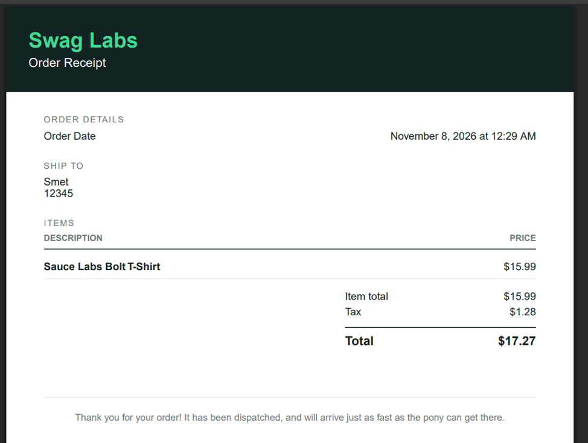

# BUG-001 - Поля оформления заказа принимают значения, состоящие только из пробелов

**Проект:** QA Portfolio - тестирование интернет-магазина  
**Приложение:** SauceDemo  
**Тип тестирования:** Ручное тестирование

## Характеристики дефекта

- **Серьёзность (Severity):** Medium
- **Приоритет (Priority):** High
- **Статус:** Подтверждён

## Предусловия

1. Выполнен вход в приложение под пользователем `standard_user`.
2. В корзину добавлен хотя бы один товар.

## Шаги воспроизведения

1. Открыть корзину.
2. Нажать кнопку **Checkout**.
3. Ввести в поле **First Name** только пробелы.
4. Ввести в поле **Last Name** только пробелы.
5. Ввести в поле **Zip/Postal Code** только пробелы.
6. Нажать кнопку **Continue**.
7. Убедиться, что открылась страница **Overview**.
8. Нажать кнопку **Finish**.

## Ожидаемый результат

Приложение не принимает значения, состоящие только из пробелов, и отображает сообщения об ошибке валидации. Переход к следующему этапу оформления заказа невозможен.

## Фактический результат

Приложение принимает значения, состоящие только из пробелов, во всех трёх полях. Пользователь может перейти на страницу **Overview** и завершить оформление заказа.

## Воспроизводимость

Дефект воспроизводится повторно. Поле **First Name** дополнительно проверялось отдельно с использованием трёх и пяти пробелов.

## Доказательства

**1. Поля оформления заказа заполнены пробелами.**

**2. Результат оформления заказа.**

