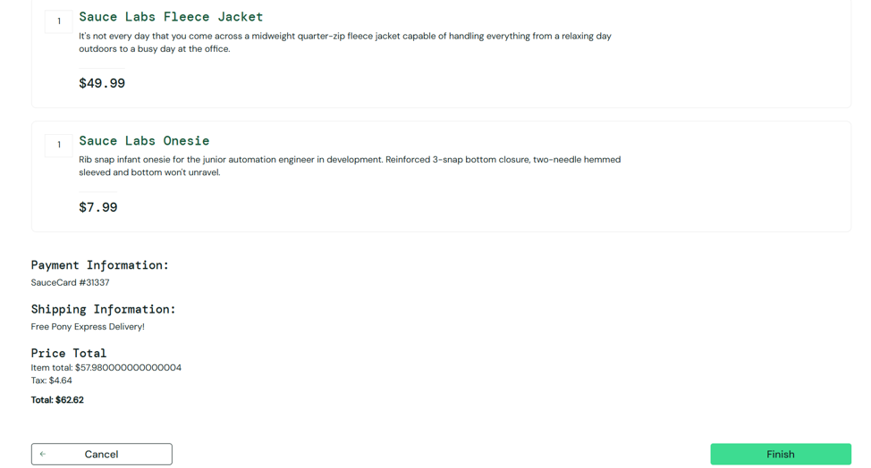
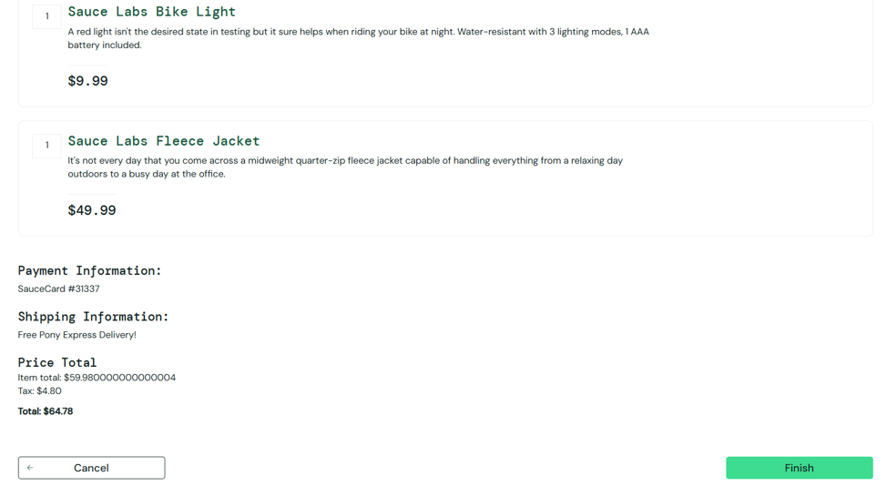

BUG-002 - Некорректное отображение промежуточной суммы заказа (Item total)

Проект: QA Portfolio - тестирование интернет-магазина
Приложение: SauceDemo
Тип тестирования: Ручное тестирование

Характеристики дефекта
Серьёзность (Severity): Low
Приоритет (Priority): Low
Статус: Подтверждён

Предусловия
•Выполнен вход под пользователем standard_user.

Шаги воспроизведения
1.Добавить в корзину Sauce Labs Fleece Jacket стоимостью $49.99 и Sauce Labs Onesie стоимостью $7.99.
2.Перейти в корзину.
3.Нажать Checkout.
4.Заполнить обязательные поля формы оформления заказа.
5.Нажать Continue.
6.На странице Overview проверить значение Item total.
7.Повторить проверку с другой комбинацией товаров: Sauce Labs Fleece Jacket ($49.99) и Sauce Labs Bike Light ($9.99).

Ожидаемый результат
Промежуточная сумма заказа отображается в денежном формате с двумя знаками после запятой.
Для первой комбинации: $57.98.
Для второй комбинации: $59.98.

Фактический результат
Вместо корректного денежного значения приложение отображает дополнительные знаки после запятой:
Для первой комбинации: $57.980000000000004.
Для второй комбинации: $59.980000000000004.
При этом налог и итоговая сумма заказа в проверенных сценариях рассчитываются корректно.

Воспроизводимость
Подтверждена на двух комбинациях товаров.

Доказательства

