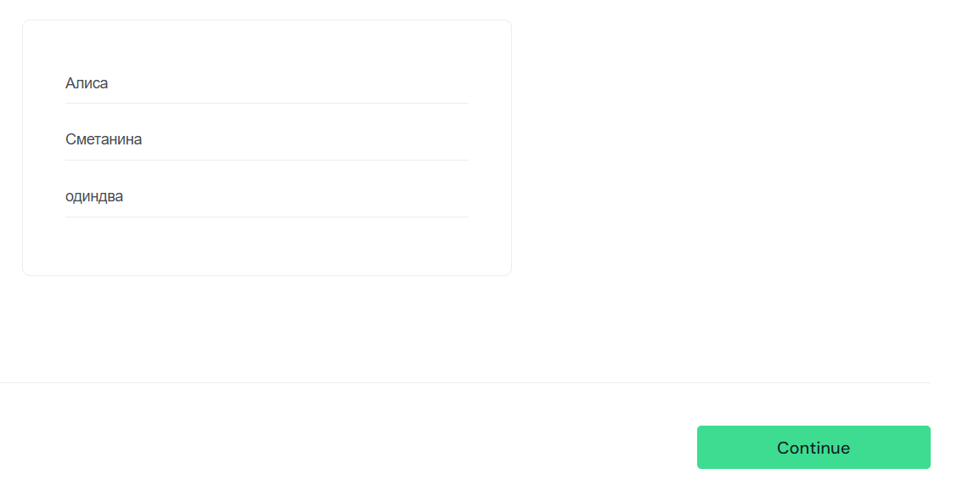
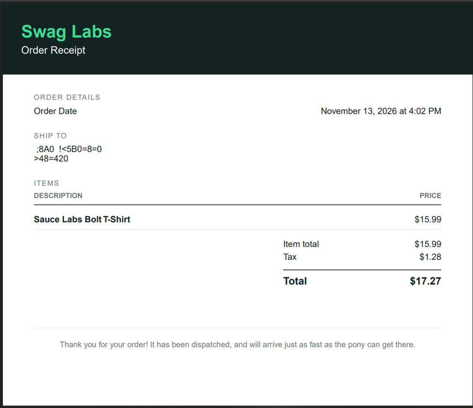

# BUG-003 - Некорректное отображение кириллицы в сформированном PDF

**Проект:** QA Portfolio - тестирование интернет-магазина  
**Приложение:** SauceDemo  
**Тип тестирования:** Ручное тестирование

## Характеристики дефекта

- **Серьёзность (Severity):** Medium
- **Приоритет (Priority):** Medium
- **Статус:** Подтверждён

## Предусловия

1. Выполнен вход в приложение под пользователем `standard_user`.
2. В корзину добавлен хотя бы один товар.

## Шаги воспроизведения

1. Перейти в корзину.
2. Нажать кнопку **Checkout**.
3. Заполнить обязательные поля формы оформления заказа.
4. Ввести фамилию кириллицей в поле **Last Name**.
5. Нажать кнопку **Continue**.
6. Завершить оформление заказа, нажав кнопку **Finish**.
7. Открыть сформированный PDF.
8. Проверить отображение фамилии в документе.

## Ожидаемый результат

Фамилия корректно отображается в PDF кириллическими символами.

## Фактический результат

Вместо кириллических букв отображается некорректная последовательность символов, например `!<5B0=8=0`.

При вводе фамилии латиницей в том же поле она отображается корректно.

## Воспроизводимость

Дефект подтверждён повторным тестированием.

## Доказательства

**1. Заполнение поля Last Name фамилией на кириллице.**

**2. Некорректное отображение фамилии в сформированном PDF.**

