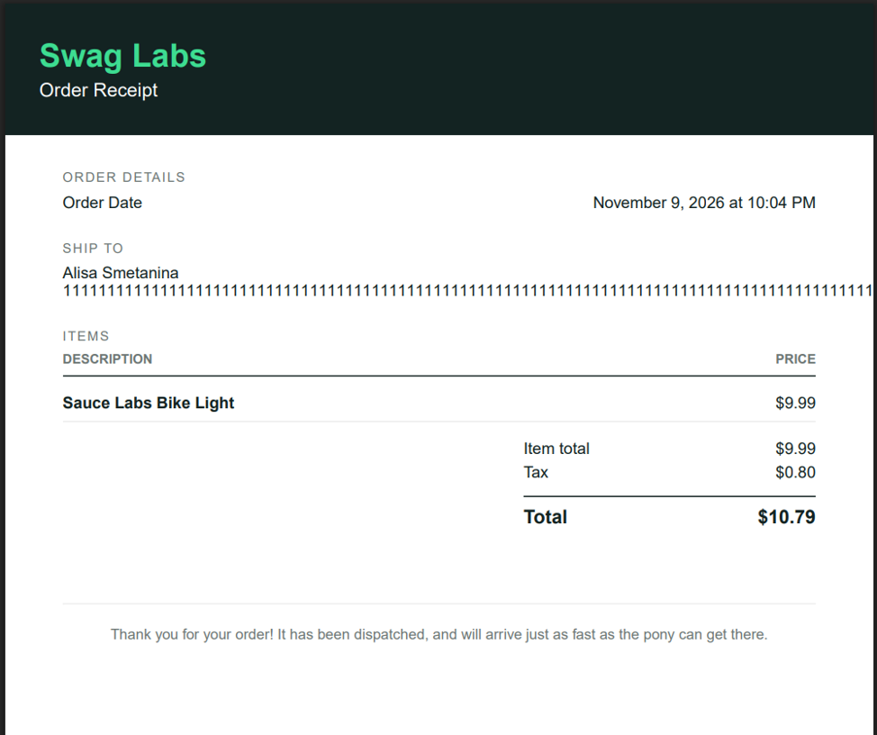

# BUG-004 - Обрезание длинного значения почтового индекса в сформированном PDF

**Проект:** QA Portfolio - тестирование интернет-магазина  
**Приложение:** SauceDemo  
**Тип тестирования:** Ручное тестирование

## Характеристики дефекта

- **Серьёзность (Severity):** Medium
- **Приоритет (Priority):** Medium
- **Статус:** Подтверждён

## Предусловия

1. Выполнен вход в приложение под пользователем `standard_user`.
2. В корзину добавлен хотя бы один товар.

## Шаги воспроизведения

1. Перейти в корзину.
2. Нажать кнопку **Checkout**.
3. Заполнить поле **First Name**.
4. Заполнить поле **Last Name**.
5. Ввести в поле **Zip/Postal Code** длинную последовательность цифр без пробелов.
6. Нажать кнопку **Continue**.
7. Завершить оформление заказа, нажав кнопку **Finish**.
8. Открыть сформированный PDF.
9. Проверить отображение почтового индекса.

## Ожидаемый результат

Введённое значение полностью отображается в PDF и не выходит за границы документа.

Если приложение ограничивает допустимую длину поля, пользователь получает понятное сообщение об ошибке.

## Фактический результат

Приложение принимает длинную последовательность цифр и позволяет завершить оформление заказа.

В сформированном PDF значение выходит за границы документа и отображается не полностью.

## Воспроизводимость

Дефект подтверждён повторным тестированием.

## Доказательства

**1. Длинное значение почтового индекса выходит за границы PDF.**

